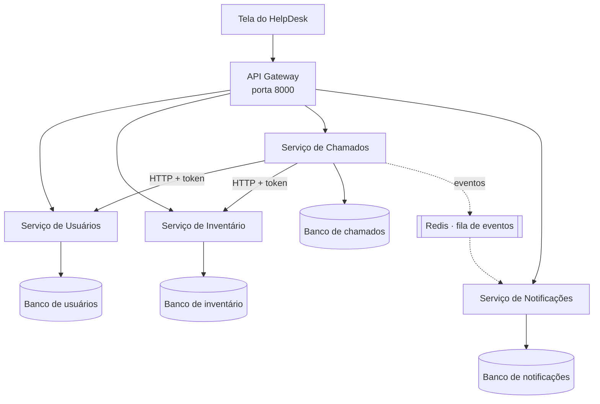
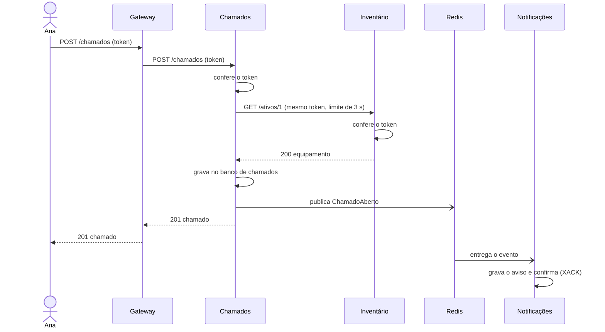

# HelpDesk TI · microsserviços


Sistema de chamados de TI (no estilo de um GLPI simplificado), feito em **Python + FastAPI**.
Este repositório é a resolução do [DESAFIO.md](DESAFIO.md) de **Arquitetura de Software**: o HelpDesk TI era um
**monólito** (uma aplicação, um banco, uma implantação) e agora são **serviços independentes**, cada um com o seu
código, o seu banco e o seu contêiner, atrás de um **API Gateway**. Nenhuma funcionalidade foi perdida.

## O que o sistema faz

- **Login** com e-mail e senha; cada pessoa vê e faz só o que o seu perfil permite.
- Cadastra **usuários** e **equipamentos** (inventário de TI).
- **Abre chamados** com prioridade e calcula o prazo de atendimento (SLA): crítica 4 h, alta 8 h, média 24 h, baixa 72 h.
- **Atribui** chamados a técnicos, controla o **status** e aceita **comentários**. Na tela, os detalhes mostram descrição, equipamento, SLA e conversa; é possível comentar sem sair da lista.
- Registra **notificações** quando um chamado é aberto, atribuído ou resolvido.
- Mostra um **painel** com totais por status e chamados atrasados.

| Ação | Solicitante | Técnico | Administrador |
|---|:-:|:-:|:-:|
| Abrir chamado | ✅ | ✅ | ✅ |
| Ver chamados | só os seus | todos | todos |
| Comentar | nos seus | todos | todos |
| Atribuir e resolver | ❌ | ✅ | ✅ |
| Fechar ou reabrir um chamado resolvido | os seus | ✅ | ✅ |
| Cadastrar equipamentos | ❌ | ✅ | ✅ |
| Cadastrar usuários | ❌ | ❌ | ✅ |

## Arquitetura



As linhas tracejadas são o **bônus** (eventos). Só o gateway é alcançável de fora do Docker.

| Serviço | Responsabilidade | Banco (volume) | Rotas pelo gateway |
|---|---|---|---|
| [`gateway`](gateway/) | Ponto único de entrada (porta 8000): serve a tela, encaminha as rotas, mostra a saúde dos serviços | não tem | todas, e `/saude` |
| [`usuarios`](usuarios/) | Cadastro de pessoas, **login** e emissão dos tokens JWT | `usuarios.db` (`usuarios-dados`) | `/auth/*`, `/usuarios*` |
| [`inventario`](inventario/) | Equipamentos (ativos de TI) | `inventario.db` (`inventario-dados`) | `/ativos*` |
| [`chamados`](chamados/) | Chamados, status, SLA, comentários e painel | `chamados.db` (`chamados-dados`) | `/chamados*` |
| [`notificacoes`](notificacoes/) (bônus) | Lê os eventos da fila e grava os avisos | `notificacoes.db` (`notificacoes-dados`) | `/notificacoes` |
| `redis` (bônus) | Fila de eventos (Redis Streams) | `redis-dados` | não tem |

### Como as peças conversam

Abrir um chamado com equipamento:



| Se... | O que acontece |
|---|---|
| o **Inventário** cai | listar usuários e chamados, comentar, atribuir e abrir chamado **sem** equipamento seguem funcionando; abrir chamado **com** equipamento responde **503** com mensagem clara, e o chamado não é criado |
| **Usuários** cai | ninguém consegue entrar e a tela não recarrega (ela precisa de `/auth/eu`); pela API, quem já tem token segue usando Chamados, Inventário e Notificações, e atribuir um técnico responde 503 |
| **Notificações** cai | os chamados seguem sendo abertos; os eventos esperam no Redis e os avisos são gravados quando o serviço volta |
| o **Redis** cai | os chamados seguem sendo abertos; os avisos daquele intervalo se perdem (veja as decisões) |
| um serviço **demora** | o gateway responde 504 (10 s); o serviço de Chamados desiste em 3 s e responde 503 |

## Como rodar

```bash
docker compose up --build
```

Só isso: **não é preciso ajustar nada** (o `.env` é opcional). Na primeira vez as imagens são baixadas e construídas.
Quando terminar de subir, abra **http://localhost:8000**. Em outro terminal:

```bash
docker compose ps        # gateway, 4 serviços e redis, todos "healthy"; só o gateway tem porta publicada
docker compose down      # para tudo (os dados ficam nos volumes)
docker compose down -v   # para tudo e apaga os volumes: bancos, fila e o segredo gerado
```

### Contas de acesso

Não é preciso criar conta: o sistema já começa com estes usuários. Todos usam a senha **`Helpdesk2026`**.

| E-mail | Perfil | O que pode fazer |
|---|---|---|
| `admin@empresa.com` | Administrador | Tudo, inclusive cadastrar usuários |
| `carla@empresa.com` | Técnica | Ver todos os chamados, atribuir, resolver e cadastrar equipamentos |
| `diego@empresa.com` | Técnico | O mesmo que a Carla |
| `ana@empresa.com` | Solicitante | Abrir chamados e ver só os próprios |
| `bruno@empresa.com` | Solicitante | O mesmo que a Ana |

- Para o fluxo completo (abrir, atribuir, resolver e fechar), entre como **Carla**.
- Para as permissões, entre como **Ana**: ela não vê os chamados do Bruno.
- As contas só são criadas com `DADOS_EXEMPLO=1` (o padrão), na primeira vez, com o banco vazio.

> Estas contas têm senha conhecida e servem só para aula. Em produção, use `DADOS_EXEMPLO=0`.

### Configuração (opcional)

Copie `.env.example` para `.env` para mudar algo. O principal é o `JWT_SEGREDO`: **o mesmo valor em todos os serviços**
(o Compose repassa). Se ficar vazio, um segredo aleatório é gerado na primeira subida e guardado num volume.
O `.env` nunca deve ir para o GitHub (já está no `.gitignore`).

### Conferir que tudo funciona

Com o sistema no ar, o script abaixo (só biblioteca padrão do Python) fala com o gateway e confere o fluxo e a segurança:

```bash
python scripts/verificar.py             # fluxo completo + segurança
docker compose stop inventario          # derruba um serviço...
python scripts/verificar.py falha       # ...e confere que o resto segue e o erro é claro
docker compose start inventario
```

## Testes

Cada serviço tem os seus testes, que rodam sozinhos, com os vizinhos simulados (`httpx.MockTransport`) e um Redis de mentira (`fakeredis`):

```bash
pip install -r requirements-dev.txt     # tudo; ou, dentro de um serviço, o requirements-dev.txt dele
python scripts/testar_tudo.py           # roda os testes de cada serviço
```

| Serviço | Testes | O que cobrem |
|---|--:|---|
| `usuarios` | 29 | login, token falso/vencido/`alg: none`/sem perfil, bloqueio de tentativas, usuário desativado, permissões |
| `inventario` | 19 | cadastro e consulta, token em todas as rotas, perfil vindo do token, limites de tamanho |
| `chamados` | 61 | regras de SLA e status, permissões por perfil, **chamadas HTTP** (token repassado, serviço fora, lento, resposta estranha), **eventos**, Redis fora |
| `notificacoes` | 24 | eventos viram avisos, sem duplicar nem travar, serviço volta e lê o que ficou na fila |
| `gateway` | 49 | rota certa para cada serviço, cabeçalhos permitidos, 503/504, `/saude`, detalhes e comentários na tela, cabeçalhos de segurança |

A cada envio ao GitHub (Actions): testes e `pip-audit` de **cada serviço**, e depois um job que sobe tudo com
`docker compose up --build` e roda `scripts/verificar.py` (inclusive derrubando o Inventário).

## Segurança

O desafio pede que a versão em microsserviços seja **tão segura quanto o monólito**. Em resumo:

- **Todo serviço confere o token** (assinatura, validade, emissor, algoritmo e perfil) antes de responder. O segredo vem do `.env` ou de um volume, **nunca do código**.
- As **permissões por perfil** continuam valendo em cada serviço (o solicitante só vê os próprios chamados).
- Ao chamar outro serviço, o **token do usuário é repassado**.
- **Só o gateway fica exposto**: os serviços, o Redis e os bancos não publicam portas e ficam numa rede interna.
- Cada serviço tem os seus **testes de segurança**.

Detalhes, diferenças em relação ao monólito e o que fazer antes de ir para produção: [SECURITY.md](SECURITY.md).

## Decisões de projeto

1. **Gateway em FastAPI + httpx, e não Nginx.** Ele precisa de mais do que repassar requisições: serve a tela, deixa passar só 3 cabeçalhos (lista de permissão), mantém os cabeçalhos de segurança e o limite de 64 KB do monólito e junta o `/saude` dos serviços. Em Python isso é código simples e testável. O custo é ter mais código que uma configuração de Nginx e continuar sendo um ponto único de falha.
2. **Um SQLite por serviço, cada um em um volume só dele.** O volume só é montado no serviço dono, então os outros nem enxergam o arquivo. Trocar para um PostgreSQL por serviço é só mudar o `DATABASE_URL`. SQLite atende uma instância por serviço, que é o que o Compose sobe.
3. **Login em um serviço só; token conferido em todos.** Só Usuários assina o JWT (HS256). Inventário, Chamados e Notificações conferem assinatura, validade, emissor e perfil **sozinhos**, com o mesmo `JWT_SEGREDO`: não chamam Usuários a cada requisição e continuam funcionando se ele cair (só o login para). O custo: **mudança de perfil ou desativação de usuário só vale nos outros serviços quando o token vence** (`TOKEN_MINUTOS`, 60 min). No serviço de Usuários, dono do dado, o usuário desativado perde o acesso na hora, como no monólito.
4. **Segredo fora do código e sem "segredo de reserva".** O monólito gerava um segredo aleatório se faltasse `JWT_SEGREDO`; com vários serviços isso quebraria o login (cada um geraria um diferente). Agora o segredo vem do `.env` ou, se estiver vazio, de um arquivo gerado na primeira subida pelo contêiner `segredos` e guardado num volume. Assim `docker compose up --build` funciona sem ajuste manual e o segredo não está no código nem na imagem. Sem um segredo de 32+ caracteres, o serviço **não sobe**.
5. **Chamadas HTTP entre serviços: token repassado, tempo limite e 503.** Chamados pergunta ao Inventário se o equipamento existe e a Usuários se o técnico existe e é técnico (os dois pontos `# vira chamada HTTP` do monólito). O token do usuário vai no `Authorization`, então o outro serviço também confere. Tempo limite de 3 s (2 s para conectar). Qualquer falha vira **503** com mensagem clara, e o que não depende do serviço fora segue funcionando. Não há nova tentativa nem "disjuntor" (circuit breaker): seria o próximo passo com tráfego real.
6. **Sem chave estrangeira entre serviços.** `solicitante_id`, `tecnico_id`, `ativo_id` e `autor_id` são só números. Chamados confere a existência na hora de gravar, mas depois não há garantia de integridade (por exemplo, se um equipamento fosse removido). Hoje nenhum serviço apaga usuários nem equipamentos; com remoção, seriam necessários eventos para manter os dados coerentes.
7. **Eventos em Redis Streams, e não Pub/Sub.** O Stream **guarda** o evento até Notificações confirmá-lo: se ela cair, os avisos são gravados quando voltar. O consumidor usa grupo de consumidores + `XACK`, e o id do evento é único no banco, então uma entrega repetida não duplica o aviso. Chamados publica **o que aconteceu** (`ChamadoAberto` com solicitante e prazo, por exemplo); quem decide destinatário e texto é Notificações. Limite conhecido: se o Redis estiver fora do ar **no instante** da publicação, o evento se perde (o chamado é salvo normalmente). O padrão "outbox" resolveria.
8. **Rede interna e só o gateway publicado.** Os serviços e o Redis ficam numa rede `internal: true` do Docker (sem porta para fora e sem saída para a internet); só o gateway também está na rede `borda` e publica `127.0.0.1:8000`. Os contêineres mantêm o endurecimento do monólito (usuário sem privilégios, sistema de arquivos somente leitura, sem capacidades extras).
9. **Código de autenticação copiado, não compartilhado.** `app/auth/tokens.py` e `dependencias.py` são iguais em Inventário, Chamados e Notificações. Assim cada serviço é um projeto que faz o build sozinho, sem pacote compartilhado. O risco é as cópias divergirem; com mais serviços, o certo é publicar uma biblioteca interna.
10. **Limite de tentativas de login em memória.** O login existe só em Usuários, então uma instância basta. O gateway informa o IP real (`X-Forwarded-For`, nunca o que o cliente mandou) e o serviço bloqueia por e-mail + IP.
11. **Dados de exemplo e ids.** Os chamados de exemplo usam ids dos usuários e equipamentos de exemplo (2 = Ana, 4 = Carla, 1 = computador...). Para o serviço de Chamados poder subir sozinho, ele cria os exemplos **sem** consultar os outros; esses ids estão documentados no código.

## O que mudou em relação ao monólito

**Ficou melhor**

- Cada serviço é **publicado, escalado e testado sozinho**; times diferentes podem trabalhar sem pisar uns nos outros.
- **Falha isolada**: com o Inventário fora do ar, o resto do sistema segue de pé.
- **Bancos separados**: cada time evolui o seu esquema sem quebrar os outros.
- Notificações ficou **desacoplada**: Chamados não conhece Notificações, só publica o que aconteceu.
- Dependências e imagens menores e mais simples em cada serviço.

**Ficou mais difícil**

- Existe uma **rede no meio**: latência, tempo limite e falha parcial passaram a ser parte do código (o 503).
- **Mais peças** para subir e observar: 6 contêineres rodando (mais o `segredos`, que roda uma vez) e logs em vários lugares.
- Sem transação nem chave estrangeira entre serviços, a **consistência** é responsabilidade da aplicação (e, com eventos, eventual).
- Código e configuração **repetidos** (autenticação, o mesmo segredo em todos).
- Testar de ponta a ponta exige subir tudo (por isso o `scripts/verificar.py`).
- Mais superfície de segurança: token repassado, rede interna, Redis.

## Rotas principais

Pelo gateway, em `http://localhost:8000`. Todas exigem login, exceto `/auth/login` e `/saude`.

| Método | Rota | Serviço | O que faz | Quem pode |
|---|---|---|---|---|
| POST | `/auth/login` | Usuários | Entra e recebe o token | Todos |
| GET | `/auth/eu` | Usuários | Dados de quem está logado | Logado |
| POST / GET | `/usuarios`, `/usuarios/{id}` | Usuários | Cria; lista (sem e-mail); consulta | Admin / logado |
| POST / GET | `/ativos`, `/ativos/{id}` | Inventário | Cria; lista; consulta equipamentos | Técnico e admin / logado |
| POST | `/chamados` | Chamados | Abre chamado em nome de quem está logado | Logado |
| GET | `/chamados`, `/chamados/{id}` | Chamados | Lista (solicitante vê só os seus); detalha | Logado |
| GET | `/chamados/painel` | Chamados | Totais por status e atrasados | Logado |
| PATCH | `/chamados/{id}/atribuir` | Chamados | Atribui a um técnico | Técnico e admin |
| PATCH | `/chamados/{id}/status` | Chamados | Muda o status | Técnico e admin (solicitante: fechar ou reabrir) |
| POST | `/chamados/{id}/comentarios` | Chamados | Comenta no chamado | Envolvidos |
| GET | `/notificacoes` | Notificações | Minhas notificações | Logado |
| GET | `/saude` | Gateway | Quais serviços estão no ar | Todos |

## Estrutura do repositório

```
.
├── docker-compose.yml     # gateway, 4 serviços, Redis, rede interna e um volume por serviço
├── .env.example           # configuração opcional
├── scripts/
│   ├── verificar.py       # fluxo, segurança e falha, pelo gateway (só biblioteca padrão)
│   └── testar_tudo.py     # roda os testes de cada serviço
├── docs/ROTEIRO-VIDEO.md  # roteiro do vídeo de demonstração
├── gateway/               # app/{main,proxy,config,seguranca_http}.py + web/ (a tela)
├── usuarios/              # cada serviço é um projeto próprio:
├── inventario/            #   Dockerfile, requirements*.txt, pytest.ini, README.md,
├── chamados/              #   app/ (main, config, database, auth/, módulo de domínio) e tests/
└── notificacoes/          #   chamados também tem app/clientes.py (HTTP) e app/eventos.py (fila);
                           #   notificacoes tem app/consumidor.py (leitor da fila)
```

## Checklist do desafio

| # | Requisito | Onde está |
|---|---|---|
| 1 | Três serviços separados | `usuarios/`, `inventario/`, `chamados/` (e `notificacoes/`, `gateway/`): cada um com Dockerfile, dependências e testes próprios; cada um roda em seu contêiner e inicia sozinho |
| 2 | Um banco por serviço | volumes `*-dados`, um `DATABASE_URL` por serviço, sem chaves estrangeiras entre serviços |
| 3 | Comunicação pela rede | `chamados/app/clientes.py` (`GET /usuarios/{id}`, `GET /ativos/{id}`) |
| 4 | Tratamento de falhas | tempo limite + 503 com mensagem clara; `chamados/tests/test_integracoes.py` |
| 5 | API Gateway | `gateway/` na porta 8000; a tela é servida por ele, sem mudar o endereço |
| 6 | Tudo sobe com um comando | `docker compose up --build` |
| 7 | Mesmas funcionalidades | abrir, atribuir, status, comentar, painel e notificações; `scripts/verificar.py fluxo` |
| 8 | Segurança mantida | seção Segurança e [SECURITY.md](SECURITY.md) |
| 9 | README | este arquivo (diagrama, como rodar e decisões) |
| Bônus | Eventos, testes por serviço e rota de saúde | Redis Streams + `notificacoes/`; Actions com matriz por serviço; `GET /saude` em cada serviço e agregado no gateway |
